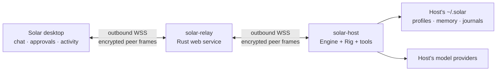

# Remote Orbits: native Rust host and relay

Status: proposed remote runtime and guided installer; not an implemented or deployed remote service. The EC2 infrastructure template linked below is present, but has not been deployed. The current desktop app runs Orbits locally. Binary names, installer actions, commands, and TOML fields below are proposed interfaces unless stated otherwise.

## Product behavior

An Orbit has a home computer. It runs on that computer using the same Rust `Engine`, Rig `AgentRun`, tools, task journal, and Orbit profile as a local Orbit. The Solar desktop app can connect to that home through our own Rust relay web service. Local and remote Orbits appear together, with a host label, connection state, current activity, chat, approvals, and completion notifications.

The user wants direct native installation with `launchd`, not a container platform or a purchased relay. Relay and host are separate roles; one machine can run both. RyServe can host the relay, but clients configure its URL so a different machine works too.

A remote Orbit executes on its own host. `shell_run` runs there, and a project path refers to that host's filesystem. Merely granting a local project does not upload it, turn its path into a remote path, or expose local desktop tools.

## Three components, one agent engine



| Component | Responsibility | Must not own |
| --- | --- | --- |
| Desktop | Pair hosts, choose Orbits, submit requests, render activity, answer approvals | Remote provider credentials or remote OS privileges |
| `solar-host` | Run local `Engine`, authorize commands, execute tools, persist tasks/events, contact model providers | Public Internet listener by default |
| `solar-relay` | Authenticate relay sessions, join authorized peer channels, forward bounded opaque frames, report connection state | Prompt/file decryption keys, provider tokens, tool execution, approval authority |

The existing `Engine` has a non-Tauri feature path and exposes `bootstrap`, `subscribe`, `send_message`, `resolve_approval`, task cancellation, and shutdown. Extract it from `src-tauri` into a shared `solar-engine` crate rather than copying it. Keep the existing Rig wrapper and provider adapters. A small `solar-protocol` crate should contain versioned commands, events, limits, and peer-channel framing; transport adapters call a typed command dispatcher, not arbitrary Tauri command names.

The desktop can also expose a host service while logged in, through the same shared host adapter. Each profile must have one Engine owner: use a profile lock and local IPC so desktop and background host never run two schedulers against the same database. A host may run several Orbits in one process initially. Separate per-Orbit processes are a later isolation option, not a second implementation of the agent loop.

## Connection and trust

Use WebSocket over TLS (`wss`) for both outbound connections. It works through ordinary NAT/firewall setups without opening an inbound port on every Orbit host. Use a maintained WebSocket implementation; RFC 6455 specifies bidirectional framing, TLS usage, frame-size limits, and reconnect backoff. [WebSocket specification](https://www.rfc-editor.org/rfc/rfc6455.html)

TLS secures each connection to the relay. Add end-to-end peer encryption because TLS alone permits the relay to read messages. Use the existing Noise protocol via a Rust implementation such as `snow`, not new cryptographic primitives. The proposed first-pair protocol is `Noise_XXpsk3_25519_ChaChaPoly_BLAKE2s` with a random 256-bit, single-use pairing secret; subsequent connections use a fresh mutually authenticated handshake with pinned static peer keys, e.g. Noise IK. Validate this exact profile and its test vectors before shipping. `snow` provides handshake and transport state; its counters belong to that session. [Noise specification](https://noiseprotocol.org/noise.html), [Snow API](https://docs.rs/snow/latest/snow/)

Pairing flow:

1. The host operator starts a short-lived pairing session locally or over an already-authenticated administrative SSH session. The host generates its identity and a one-use invitation with a five-minute expiry.
2. Solar scans the QR code or accepts the full invitation through a deliberately trusted channel. The invitation contains the relay URL, random channel ID, and high-entropy secret. A six-digit code alone is not the secret.
3. The peers complete the encrypted handshake and show host name/key fingerprint for confirmation. The handshake binds the invitation and protocol version; both sides persist the peer identity and assigned rights only after successful pairing.
4. Consume the invitation atomically. Rate-limit failures and expire unused sessions. Each new device requires its own pairing; invitations never grant access to every future device automatically.
5. Reconnect with fresh session keys and verify the pinned peer. A changed identity requires explicit re-pairing. No zero-RTT commands or silent trust-on-first-use during reconnect.

Relay authentication and end-to-end identity are separate. Give each device a revocable relay credential; send it in an authorization header, never a URL query. Store only hashes of bearer credentials server-side. Host-side peer ACLs remain authoritative even if the relay is compromised. Revoking a peer closes its channel, removes its host permissions, and prevents new commands. The relay can observe IPs, online state, timing, and approximate message sizes and can deny delivery; it cannot be described as metadata-private.

Keep private keys in macOS Keychain or a host-specific secret provider. Keep non-secret configuration in TOML. Never commit shared relay secrets, copy desktop provider tokens to the relay, or reuse the remote diagnostic logging key as an authentication key.

## Remote command and activity protocol

Start with an allowlisted, versioned protocol, rather than remote shell access to the daemon:

| Command | Host validation |
| --- | --- |
| `ListOrbits`, `GetSnapshot`, `SubscribeEvents` | Paired peer may view the named Orbit |
| `SendMessage` | Peer may run the named Orbit; validate conversation membership and input size |
| `CancelTask` | Peer has cancellation rights for that task/Orbit |
| `ResolveApproval` | Peer has approval rights; bind approval ID to task, call, argument hash, and current permission revision |
| `UploadArtifact`, `DownloadArtifact` | Explicit transfer grant, allowed project, quota, safe relative path |

Every command contains a UUID request ID and target host/Orbit. Persist `(peer_id, request_id, payload_hash, result)` before accepting state-changing work. Retrying the same ID returns the recorded outcome; the same ID with different content is rejected. An acknowledgement distinguishes accepted/persisted work from a merely delivered frame. A disconnection after acknowledgement does not start another task.

The host owns a durable event journal with increasing sequence numbers for message deltas/checkpoints, task state, tool start/result, approvals, attention, and artifact availability. The current broadcast channel is a live feed, not a durable remote event log. Reconnecting clients request a snapshot and events after their last acknowledged cursor. Coalesce text deltas; bound retained events and issue `resync_required` when a cursor is too old. Never drop approval, terminal-task, or cancellation state without a snapshot path.

At first, the relay forwards live encrypted frames only. Offline messages/events stay on their originating host; do not persist old Noise transport ciphertext and replay it into a new session. After reconnect, authenticate a new channel and encrypt newly serialized journal events under fresh keys. Offline command submission must visibly remain “not sent” until the host acknowledges it. Store-and-forward is a separate phase requiring its own encrypted-envelope design and expiry semantics.

Preserve Solar's existing rules: model retries do not repeat host effects; pending approvals wait without executing; an Orbit host restart marks interrupted tasks and closes unanswered tool-call pairs without replaying uncertain actions. A desktop reconnect is different from a host restart. Activity rendering must distinguish offline, running, waiting for approval, stopped, completed, failed, and interrupted.

## Tools, projects, and remote data

Advertise every tool the host actually implements, including shell, configured MCP tools, and installed browser capability. Capability absence is distinct from a user tool-category restriction: a headless server cannot capture a Mac screen that is not there. Display host capabilities and explain unavailable native features. Preserve execution approvals and folder boundaries independently of tool discoverability.

A project granted to a remote Orbit must name a directory on its host or an explicitly transferred snapshot. Use a stable project ID and host mapping, not a local absolute path in a chat prompt. Phase one supports host-local projects plus explicit individual artifact upload/download. Automatic folder synchronization comes later, with a manifest, hashes, version/conflict handling, quotas, and a preview of what leaves the computer. Never sync all of `~/.solar`, private Orbit memory, credentials, `.git` credentials, or unrelated project files implicitly.

Artifact transfers use authenticated encrypted chunks, a maximum total size, per-chunk integrity checks, and atomic final rename into an authorized destination. Reject traversal, absolute paths, symlink escapes, executable overwrite outside the target, and expansion bombs. Do not put file contents in relay diagnostics.

Local desktop screen sharing and app control are not automatically forwarded to remote Orbits. A future device-tool bridge can make them available under an explicit, revocable, time-bounded local sharing session. The local machine retains approval authority for those actions.

## Guided setup and SSH deployment

The intended setup wizard does the routine installation work. The user selects **Connect a computer** or **Create an AWS host**; Solar shows one progress view for connection, machine checks, installation, service startup, pairing, and readiness. A failure reports the failed stage and a retry action, retaining safe completed steps rather than restarting blindly.

For an existing computer, accept an SSH host alias from `~/.ssh/config` first, with optional host/user/port/key overrides. Use the system OpenSSH client so existing `Host` blocks, `ProxyJump`, `IdentityFile`, agent identities, hardware keys, and `known_hosts` continue to work. Do not copy private keys into Solar. Inspect effective settings with `ssh -G` without printing identity or proxy details into telemetry. Probe access with a short timeout and `BatchMode=yes`; this checks existing authentication without prompting unexpectedly.

If a key needs unlocking, distinguish that from the remote account password. Offer the system SSH agent/Keychain unlock path. If no existing authentication succeeds, request the remote password using a secure native prompt and pass it only to an interactive SSH authentication channel; never place it in process arguments, a shell command, an environment variable, TOML, telemetry, or a saved transcript. Do not use `sshpass`. Keep optional sudo authentication separate and explain why installation needs it; do not infer that a login password grants sudo. Offer installing a user-approved public key for later management, with an exact key preview and idempotent authorized_keys update.

An unknown SSH host key requires a fingerprint confirmation before trusting it. Existing keys must match; never use `StrictHostKeyChecking=no` or throw away `known_hosts`. A network-fetched `ssh-keyscan` value is a candidate fingerprint, not proof of identity. Changed keys stop setup until the user verifies and explicitly replaces the known key. These behaviors follow OpenSSH's authentication and host-key settings. [OpenSSH client configuration](https://man.openbsd.org/ssh_config)

After authentication, a fixed installer probes OS/version/architecture, libc/ABI compatibility, available disk, an existing Solar install, service ownership, and privilege mode. It selects a signed/checksummed release built for that machine and its ABI, stages it over SSH, verifies it remotely, writes configuration atomically, installs the correct launchd/systemd service, starts it, and waits for an authenticated health check. Do not pipe a downloaded script into a privileged shell. The installer then pairs the host automatically over that already-verified SSH channel; the user should not transcribe a second invitation secret. The finish screen shows host identity, installed version, service state, and where to manage or remove it.

An x86_64 binary built against a newer Ubuntu glibc cannot be assumed to run on Amazon Linux 2023. Build the headless binary against the target distribution or a verified compatible/static target, and reject an unsupported ABI before installation. These installer operations are proposed, not present in the current desktop. They require the actual `solar-host` release artifact and typed host service first. Re-running setup must not overwrite existing Orbits, provider credentials, or project data. Upgrades preserve an old verified binary for rollback and hold the profile lock while switching versions.

## AWS host foundation

[`infra/cloudformation/solar-host.yaml`](../infra/cloudformation/solar-host.yaml) is an infrastructure template for one native Amazon Linux 2023 x86_64 EC2 host. It creates an encrypted gp3 root volume, requires IMDSv2, restricts inbound traffic to administrator SSH from an explicitly supplied `/24`–`/32` CIDR, and opens no public Orbit or relay port. It uses an existing VPC, public subnet, and EC2 key pair, avoiding a new VPC/NAT stack. The selected instance sizes are x86_64 to match the AMI. AWS documents the public AL2023 AMI parameter and its architecture requirements. [AL2023 AMIs](https://docs.aws.amazon.com/linux/al2023/ug/ec2.html), [IMDS options](https://docs.aws.amazon.com/AWSCloudFormation/latest/TemplateReference/aws-properties-ec2-instance-metadataoptions.html)

Its user data creates an unprivileged `solar` account and owner-only `/home/solar/.solar` directories. It deliberately does not contain provider credentials, pairing secrets, a fictional release URL, or a pretend running service. Optional Session Manager support adds only the AWS-managed instance-core role; the default uses SSH without an instance role. A guided deploy must wait for EC2 status and `cloud-init`, then install a real verified host binary and its systemd unit over the authenticated management connection. [SSM role](https://docs.aws.amazon.com/aws-managed-policy/latest/reference/AmazonSSMManagedInstanceCore.html)

The AWS wizard should use the user's existing AWS credential chain/profile, discover VPC/subnet/key-pair choices, suggest the current public IP `/32`, preview the CloudFormation change set, and show estimated running resources before execution. Avoid asking for AWS secret keys when an authenticated profile already exists. Creating or running this stack incurs EC2, EBS, and public IPv4 charges. The template retains the EC2 instance on stack deletion/replacement to protect its data, so retained instances still accrue charges; deleting the stack alone is not a stop or cleanup action. The user can terminate a retained host after backing up its data. No AWS resources have been created as part of adding this template.

AWS deployment waits until the host/relay binaries and guided installation are ready. The first deployed relay remains closed to public traffic until its domain, TLS certificate, relay authentication, and peer pairing pass health checks. A host-only EC2 machine needs outbound relay/model access and administrator SSH; it does not need inbound HTTPS.

## Native installation and launchd

Run Rust binaries in the foreground. `launchd` owns their lifecycle; do not fork/daemonize internally. On `SIGTERM`, stop accepting work, cancel/checkpoint running tasks, close channels, and exit within a bounded shutdown period. A lost relay connection triggers capped exponential backoff with jitter, not process restart loops. Apple documents per-user LaunchAgents, system LaunchDaemons, job ownership, and foreground process behavior. [Creating launchd jobs](https://developer.apple.com/library/archive/documentation/MacOSX/Conceptual/BPSystemStartup/Chapters/CreatingLaunchdJobs.html)

Use a **LaunchAgent** for a host that uses a person's Keychain, desktop session, browser, or screen. It runs only while that user is logged in. A **LaunchDaemon** is suitable for an always-on headless host or relay under a dedicated unprivileged service account; it cannot display desktop UI. Do not run Orbits or shell tools as root. Authentication that requires interactive Keychain unlock must be resolved during provisioning; do not promise it works at boot while logged out. [Apple's daemon/agent guidance](https://developer.apple.com/library/archive/documentation/MacOSX/Conceptual/BPSystemStartup/Chapters/DesigningDaemons.html)

Proposed user installation:

```text
~/.solar/bin/solar-host
~/.solar/config.toml
~/.solar/orbits/<orbit_name>/config.toml
~/.solar/remote/peers.toml
~/.solar/remote/events.sqlite
~/Library/LaunchAgents/net.solar-chat.host.plist
```

Illustrative LaunchAgent template; the installer must replace `/Users/ACCOUNT` with the actual home directory, create log directories, set owner-only data permissions, and validate the executable before loading. These interfaces are not available in the current build.

```xml
<?xml version="1.0" encoding="UTF-8"?>
<!DOCTYPE plist PUBLIC "-//Apple//DTD PLIST 1.0//EN" "http://www.apple.com/DTDs/PropertyList-1.0.dtd">
<plist version="1.0"><dict>
  <key>Label</key><string>net.solar-chat.host</string>
  <key>ProgramArguments</key><array>
    <string>/Users/ACCOUNT/.solar/bin/solar-host</string>
    <string>serve</string>
    <string>--config</string><string>/Users/ACCOUNT/.solar/config.toml</string>
  </array>
  <key>RunAtLoad</key><true/>
  <key>KeepAlive</key><true/>
  <key>ThrottleInterval</key><integer>10</integer>
  <key>StandardOutPath</key><string>/Users/ACCOUNT/.solar/logs/host.out.log</string>
  <key>StandardErrorPath</key><string>/Users/ACCOUNT/.solar/logs/host.err.log</string>
</dict></plist>
```

A relay on a dedicated Mac uses an analogous `/Library/LaunchDaemons/net.solar-chat.relay.plist` with `UserName` set to its service account and these program arguments:

```xml
<key>ProgramArguments</key><array>
  <string>/Users/SERVICE_ACCOUNT/.solar/bin/solar-relay</string>
  <string>serve</string>
  <string>--config</string><string>/Users/SERVICE_ACCOUNT/.solar/relay/config.toml</string>
</array>
<key>UserName</key><string>SERVICE_ACCOUNT</string>
```

The relay's database, pairing metadata, TLS certificate references, and bounded content-free logs live under that account's `~/.solar/relay`. Bind TLS directly with a maintained Rust TLS stack, or bind loopback behind an existing trusted TLS proxy; neither requires a container. Keep host and relay data directories separate even when co-located. Linux can use the same binaries under systemd later, with secrets supplied by the service manager or an OS secret store; Linux provider credentials are currently session-only in Solar and need a durable provisioning path before unattended reboot support.

For macOS distribution, sign the host/relay executables and make updates atomic. An update must stop/checkpoint the owner, verify the new binary, replace it, then restart; a failed update restores the previous binary. Never install a second Engine against a live profile.

## Notifications

While Solar is running, remote `AttentionItem` events feed the existing peek/chime and activity UI. Preserve chat-visible suppression and approval priority; one event ID must not create duplicate alerts after reconnect. A remote Orbit continues after the launcher window closes if the Solar process still runs.

If Solar is fully quit, the relay cannot draw a widget or deliver a local chime. Keep the completed event on the host for the next reconnect. True notifications while the app is not running require a separate APNs integration and signed application entitlement; APNs payloads should contain only a generic wake/notification hint, with details fetched through the encrypted peer channel. Do not silently fall back to email or another messaging service. [Apple APNs requests](https://developer.apple.com/documentation/usernotifications/sending-notification-requests-to-apns)

## Implementation sequence and acceptance

1. **Shared engine and native host.** Extract `solar-engine`, add a foreground `solar-host`, profile lock, safe shutdown, local-only control adapter, host capability snapshot, and launchd installer/uninstaller. Validate desktop behavior and one Engine per profile. No remote listener enabled yet.
2. **Relay and pairing.** Add `solar-relay` with health endpoint, bounded WSS routing, short-lived invitations, peer revocation, authenticated Noise channels, and direct native installation. Validate tampering, wrong peer/secret, expired/reused invite, changed identity, frame limits, and connection backoff.
3. **Usable remote Orbit.** Wire typed commands, persistent event cursors, approval responses, cancellation, remote host badges, activity detail, and notifications while Solar runs. Test dropped connections before/after acknowledgement, duplicate commands, peer revocation while waiting, host restart mid-tool, stale approvals, and no duplicated shell execution.
4. **Explicit artifacts and mixed groups.** Add transfer grants and host project mappings. Permit local/remote Orbits in a group only after task/ancestry permissions and cancellation propagate end-to-end. Validate no implicit memory/credential sharing and no delegation cycles across hosts.
5. **Optional later features.** Automatic project sync, offline submission, APNs wakeups, browser-only dashboard, and separate per-Orbit process isolation. Each is an addition to the protocol, not a requirement for first remote chat.

No additional infrastructure decision is needed to implement the first three phases: make the relay URL configurable and default the installer to native launchd jobs. Actual deployment needs the target relay machine/domain/TLS path and an operator-authorized installation. Provisioning a remote Orbit additionally needs its provider credentials on that host, authorized project locations, and a choice between logged-in desktop capabilities or unattended headless operation. Those are host setup inputs, not reasons to redesign the agent runtime.
